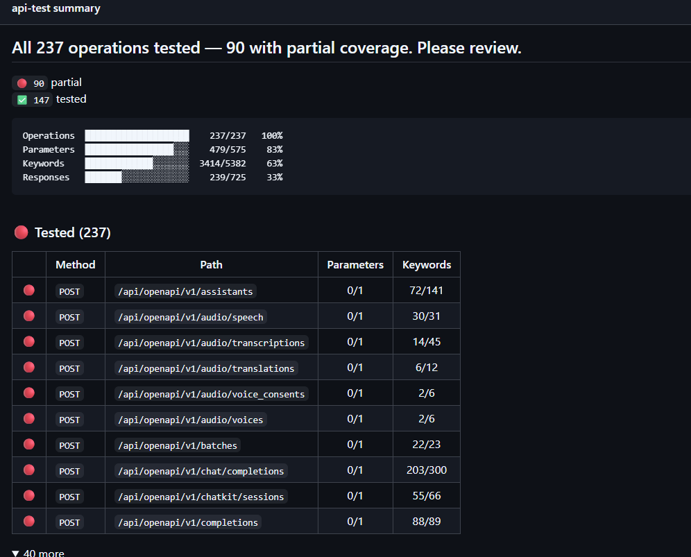
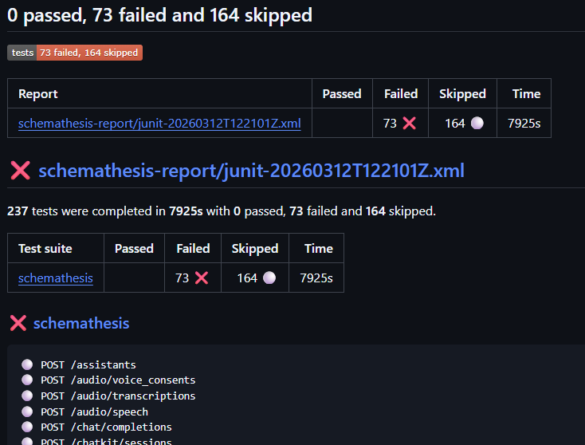

# Schemathesis GitHub Action

Run [Schemathesis](https://github.com/schemathesis/schemathesis) property-based tests against your OpenAPI, GraphQL or gRPC API.

```yaml
- uses: schemathesis/action@v3
  with:
    # API schema location
    schema: 'https://example.schemathesis.io/openapi.json'
```

## Configuration

```yaml
- uses: schemathesis/action@v3
  with:
    # API schema location (URL or file path)
    schema: 'https://example.schemathesis.io/openapi.json'
    # Override the base URL from the schema
    base-url: 'https://example.schemathesis.io/v2/'
    # Checks to run (default: all except `max_response_time`)
    checks: 'not_a_server_error'
    # Seconds to wait for the schema to become available (default: 2)
    wait-for-schema: '30'
    # Test cases per API operation (default: 100)
    max-examples: 50
    # Schemathesis version (default: latest)
    version: 'latest'
    # Python module path for hooks
    hooks: 'tests.hooks'
    # Path to a `schemathesis.toml` configuration file
    config-file: 'tests/schemathesis.toml'
    # Authorization header value
    authorization: 'Bearer ${{ secrets.API_TOKEN }}'
    # Extra CLI arguments
    args: '--exclude-deprecated'
    # Report formats to write and upload as an artifact (default: none)
    report: 'junit,json'
    report-artifact-name: 'schemathesis-report'
    # Track schema coverage (default: true)
    coverage: 'true'
    # Upload the HTML coverage report as an artifact (default: true)
    coverage-report: 'true'
    coverage-report-path: 'schema-coverage.html'
    coverage-artifact-name: 'schema-coverage-report'
    # Post the coverage summary as a PR comment (default: true)
    coverage-pr-comment: 'true'
    # Add the coverage summary to the job summary (default: true)
    coverage-step-summary: 'true'
    # List the failures found by Schemathesis in the job summary (default: true)
    failures-step-summary: 'true'
```

`authorization` sets the full `Authorization` header, so any scheme works:

```yaml
    authorization: 'Basic ${{ secrets.ENCODED_CREDENTIALS }}'
```

`args` passes extra flags to `schemathesis run`. See the [CLI reference](https://schemathesis.readthedocs.io/en/stable/reference/cli/) for the full list. The action splits `args` the way a shell does, so quote arguments that contain spaces. It expands `$VAR` and `${VAR}` from the environment, even inside single quotes, and passes `$(...)`, backticks, globs and braces through as literal text.

`checks` and `max-examples` override `schemathesis.toml` when set. Leave them out to use the config file. `wait-for-schema` always overrides it, so set the wait with the input.

## Failures in the job summary

When Schemathesis finds failures, the job summary shows a table of the failing operations and the failures found in each. Reproduction steps are in the step log.

The action reads the failures from a Schemathesis JSON report in a temporary directory. If you configure the JSON report yourself (`report: 'json'`, `--report=json` or `--report-json-path` in `args`, `[reports.json]` in `schemathesis.toml`), your report keeps its path and the list is skipped. Schemathesis versions without `--report-json-path` skip it too.

The `failures-summary` output holds the path to the list in Markdown. It is empty when the run has no failures.

To turn the list off:

```yaml
    failures-step-summary: 'false'
```

## gRPC

Point `schema` at a server with reflection enabled, or at a descriptor set and pass the server in `base-url`:

```yaml
- uses: schemathesis/action@v3
  with:
    schema: 'grpc://127.0.0.1:50051'

- uses: schemathesis/action@v3
  with:
    schema: 'api.binpb'
    base-url: 'grpc://127.0.0.1:50051'
```

The action installs the `grpc` extra when `schema` starts with `grpc://` or `grpcs://`, or ends with `.binpb`, `.pb`, `.protoset` or `.desc`. gRPC needs Schemathesis 4.33.0 or later. Coverage reports are skipped for gRPC, since tracecov does not support it.

## Coverage reports

[tracecov](https://tracecov.sh) measures how much of your schema the tests exercised. Coverage is on by default, and each run produces:

- a summary in the job summary
- an HTML report, uploaded as the `schema-coverage-report` artifact
- a PR comment with the summary, on `pull_request` and `pull_request_target` events

The action writes these reports even when Schemathesis finds failures.


The job summary looks like this:



For PR comments, grant the job `pull-requests: write`. A job-level `permissions` block drops every permission you don't list, so keep `contents: read` for `actions/checkout`:

```yaml
jobs:
  test:
    permissions:
      contents: read
      pull-requests: write
    steps:
      - uses: schemathesis/action@v3
        with:
          schema: 'http://example.com/api/openapi.json'
```

The action updates its own comment on each push instead of posting a new one. Without `pull-requests: write`, or on pull requests from forks where the token is read-only, the action skips the comment and the step still passes.

To turn coverage off:

```yaml
    coverage: 'false'
```

### Running the action more than once

Each run uploads an artifact, and artifact names must be unique within a workflow run. Give each run its own name:

```yaml
- uses: schemathesis/action@v3
  with:
    schema: 'http://example.com/api/v1/openapi.json'
    coverage-artifact-name: 'coverage-v1'

- uses: schemathesis/action@v3
  with:
    schema: 'http://example.com/api/v2/openapi.json'
    coverage-artifact-name: 'coverage-v2'
```

Each artifact name gets its own PR comment, labelled with that name. Set `coverage-pr-comment: 'false'` on the runs whose comment you don't need. In a single job, set `coverage-step-summary: 'false'` on all but one run to keep the job summary readable.

## Outputs

| Output | Description |
| --- | --- |
| `coverage-report-url` | URL of the uploaded HTML coverage report artifact. Empty when `coverage` or `coverage-report` is `'false'`. |
| `report-path` | Directory with the reports. Empty when `report` is not set. |
| `report-url` | URL of the uploaded report artifact. Empty when `report` is not set. |

## Reports

`report` takes a comma-separated list of [report formats](https://schemathesis.readthedocs.io/en/stable/reference/cli/), such as `junit` or `json`. Schemathesis writes them to `schemathesis-report/`, and the action uploads that directory as the `schemathesis-report` artifact, even when Schemathesis finds failures.

When the action runs more than once in a workflow, give each run its own `report-artifact-name`, as with `coverage-artifact-name`.

### Test results in the job summary

Publish the JUnit XML file with [dorny/test-reporter](https://github.com/dorny/test-reporter):

```yaml
- uses: schemathesis/action@v3
  with:
    schema: 'http://example.com/api/openapi.json'
    report: 'junit'

- name: Publish test report
  uses: dorny/test-reporter@v2
  if: always()
  with:
    name: Schemathesis
    path: schemathesis-report/*.xml
    reporter: java-junit
```

dorny/test-reporter needs `checks: write` permission. The step uses `if: always()` because the action step fails when Schemathesis finds a problem.



### Machine-readable results

`report: 'json'` writes the run's results to one JSON file. Download the artifact and hand the file to a script or an AI assistant to triage the failures.

## Resources

- [Documentation](https://schemathesis.readthedocs.io/en/stable/)
- [CLI Reference](https://schemathesis.readthedocs.io/en/stable/reference/cli/)
- [GitHub Issues](https://github.com/schemathesis/schemathesis/issues)
- [Discord](https://discord.gg/R9ASRAmHnA)
